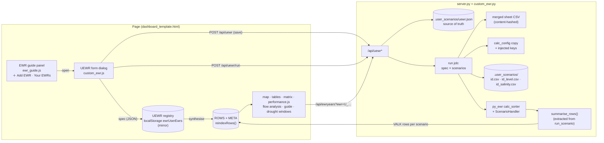

# Custom EWR Builder: implementation guide

This guide plans the **Custom EWR Builder**. The builder adds an **Add EWR** button to the EWR guide and a form for defining flow, level or salinity EWRs. A new evaluation path runs each definition on every uploaded scenario through py_ewr. The finished custom EWR then appears in every view where it applies, and deleting it removes it from all of them.

The guide is based on the code at `13d3056` (py_ewr 2.4.11). Line numbers point at that commit.

---

## 0. What the codebase looks like, and the constraints that shape the design

| Layer | What is there today | What it means for this feature |
|---|---|---|
| Frontend | No framework. One template, `src/dashboard_template.html` (about 1,500 dense lines), holds the markup, CSS and JS. `src/ewr_guide.js` and `src/performance.js` are inlined into it by `src/build_dashboard.py` (`render_html`, the `__EWR_GUIDE_JS__` and `__PERFORMANCE_JS__` slots). | The new UI is plain DOM code, written as a third inlined module: `src/custom_ewr.js`. |
| State | A global `S` object (`dashboard_template.html:158`). Data lives in global tables: `ROWS`, `META`, `CUSTOM` (uploaded scenarios), `CEWR` (heat-map "custom constraints") and `EWRLIST` (EWRs per gauge, fetched from the server). Persistence uses `localStorage` (`ewrCustomScenarios`, `ewrCustomEwr`, `ewrGuideSel` and others). After any change the page calls `refresh()` to repaint. | A custom EWR becomes a new registry, `UEWR`. It plugs into the same tables and then calls `refresh()`. |
| Results model | `ROWS` holds one row per (planning unit, SDL unit, gauge, EWR). Each row has per-scenario arrays: FR `r[6]`, ETP `r[7]`, achieved years `r[9]`, worst gap `r[10]`, duration ratio `r[11]` and drought windows `r[12]`. Each uploaded scenario adds a column index `P*NC` (`addCustom`, `:1256`). `putVals` writes one server result row (`VALK`, `:1249`) into that column. | **An uploaded result row is shown only if `PUKEY` already has a matching row** (`:1259`). A custom EWR code matches no review row, so its results would be **silently dropped**. The page has to create new `ROWS` entries for every custom EWR. |
| Derived indices | `sdlRows` and `gaugeRows` (`:307`), `PUKEY` (`:1254`) and the theme list `r.t` (`:150`) are all built **once at load**. | These need a `reindexRows()` that runs whenever custom EWR rows are added or removed. |
| Backend | `src/server.py` is a stdlib `ThreadingHTTPServer`. Long runs go through jobs: `JOBS`, a worker thread, polled with `/api/job`. Each gauge is evaluated in a `ProcessPoolExecutor` (`evaluate_gauges`). Uploaded **flows** are kept in `.user_scenarios/<id>.csv`. | "Run through all scenarios" reuses the job and polling pattern and the same pool. |
| Series storage | `run_scenario` stores `df_F` (flows) only. `df_L` (levels) is thrown away after the run. Salinity is never read: py_ewr's `cleaner_standard_timeseries` keeps only `*_flow` and `*_level` columns. | Level and salinity EWRs need two new stored series per scenario. |
| Evaluable scenarios | The review results (`data/results/*.csv`) are summary metrics with no daily series. Notebook-embedded scenarios (`PRELOADED`) have no server id. | **Only uploaded "Your data" scenarios with stored series can be evaluated.** In Demo data mode custom EWRs are hidden, and the UI has to say why. |
| Name clash | A "Custom constraints" feature already exists (`CEWR`, `customForm`, `:727` and `:790`). It adds unevaluated threshold overlays to the heat map, stored in `localStorage["ewrCustomEwr"]`. | Name the new feature **user EWRs** (`UEWR`, key `ewrUserEwrs`, code prefix `U_`) so it does not collide. See §7 on whether to retire CEWR later. |

### How py_ewr dispatches an EWR (and the two traps)

`evaluate_EWRs.calc_sorter(df_F, df_L, gauge, EWR_table, calc_config)` picks the handler for each row of `EWR_table` by **exact string key**: `f"{Code}-{single|multigauge}-{FlowLevelVolume}"`. The key is looked up in `calc_config` (`parameter_metadata/ewr_calc_config.json`). An unknown key is logged and skipped. Two consequences:

1. **A custom code needs its own key injected into a private copy of `calc_config`.** For example, `cfg["flow_handle"].append("U_FRESH1-single-F")`. The code can never contain `-`, because the key is split on it.
2. **`ScenarioHandler` summaries re-read the parameter sheet from a file path.** These are `get_ewr_results`, `get_all_successful_events` and `get_all_successful_interEvents`. They call `summarise_results.join_ewr_parameters` and pass it `ScenarioHandler(..., parameter_sheet=<path>)`. Passing an in-memory table is not enough: TargetFrequency, MaxInter-event and MinSpell come back empty and the successful-events filter fails. The custom rows must be **written to a merged CSV**. `get_EWR_table` is TTL-cached by path, so name the file by a hash of its content.

### Prototype result

A throwaway script (not committed) tested this mechanism on `data/example_scenarios/dummy_broken_scenario_A.csv` at gauge 404216. It merged base sheet and custom rows into a CSV, injected the calc-config keys, then ran `calc_sorter` and `ScenarioHandler(parameter_sheet=path).get_ewr_results()`.

| Custom row | Handler | EventYears / Frequency % | Target % |
|---|---|---|---|
| `USR_FRESH` ≥ 200 ML/d × 5 d, Oct–Apr, gap tolerance 1 | `flow_handle` | 15 / 60 | 50 |
| `USR_BASE` ≥ 20 ML/d, 200 days/yr | `lowflow_handle` | 7 / 28 | 90 |
| `USR_CTF` ≤ 1 ML/d for 60 d | `ctf_handle` | 0 / 0 | 100 |
| `USR_VOL` 20 GL in 30 d, 15 Jul–Nov (`7.15`) | `cumulative_handle` (V) | 4 / 16 | 40 |
| `USR_SAL` EC ≤ 800 for 30 d, Dec–Mar (synthetic EC series passed as `df_F`) | `flow_handle` | 25 / 100 | 80 |

Two more findings from the prototype:

- **`MinSpell` must always be set.** `lowflow_handle` crashes on `None >= int`. The real sheet never leaves it blank (0% missing). Default it to `Duration` for spell handlers and to `1` for `lowflow_handle`.
- **py_ewr's `*_calc` functions don't care about units.** They compare values against `min_flow` and `max_flow`. So **salinity runs through py_ewr unchanged**: pass the salinity series as `df_F` and put the EC limits in `FlowThresholdMin` and `FlowThresholdMax`. No separate salinity engine is needed. FR, ETP, gaps and drought windows all fall out of the existing summary code.

The level path (`level_handle` on `df_L`) uses the same mechanism. It was not run in the prototype because the example files have no level columns. Add a level fixture first (§6, Phase 1).

---

## 1. Architecture overview



### Source of truth and data flow

1. **Definition (spec).** The **server registry** `.user_scenarios/uewr.json` is authoritative. It has to be, because the per-EWR chart endpoints (`/api/ewryears`, `/api/interevents`, the annual raster) evaluate on the server by `code`. The page mirrors the registry in `localStorage["ewrUserEwrs"]`, so it can draw the guide list before the server answers, and works offline in a degraded, read-only mode.
2. **Results.** Each scenario's results are `VALK` rows (`pu, gauge, ewr, fr, et, ey, ny, sev, dr, nm, win`), exactly what `/api/run` returns today. They are merged into that scenario's `CUSTOM[i].vals`, so the existing `persistCustom()` and `restoreCustom()` keep them across reloads. Each result also carries the spec version it was computed from (`uewrVer`), so edits can mark results **stale**.
3. **Rows.** For each spec the page builds one `ROWS` entry per (planning unit × SDL unit) the gauge belongs to. Then `putVals` fills the scenario columns as for any uploaded result. Every view reads `ROWS`, so the custom EWR shows up everywhere without per-view code, apart from the few places listed in §5.3.

### Spec schema (shared by page and server)

```jsonc
{
  "id": "u_k2f9x1",              // server-assigned, [a-z0-9_]{1,24}
  "ver": 3,                      // +1 on every edit; results carry the ver they were computed with
  "code": "U_FRESH1",            // ^U_[A-Za-z0-9]{1,20}(_[A-Za-z0-9]{1,8})?$ : no "-", unique, not a sheet code
  "name": "Spring fresh for golden perch",   // free text ≤ 80 chars (display only)
  "kind": "F",                   // F flow · V volume (flow family in the UI) · L level · S salinity
  "handler": "flow_handle",      // allow-listed per kind (§2)
  "gauge": "404216",             // must be a review gauge (META.gauges)
  "second_gauge": null,          // multigauge flow handlers only
  "pus": ["Broken River Reach 2: Hollands Creek to Caseys Weir"],  // ≥1, from the sheet rows at that gauge
  "objectives": ["NF1", "NF4"],  // META.objs; empty → theme "Unclassified"
  "regime": "Small fresh",       // META.regimes or null
  "params": {                    // parameter-sheet column names, values as numbers (server renders them to sheet strings)
    "StartMonth": 9, "StartDay": 15, "EndMonth": 12, "EndDay": null,
    "FlowThresholdMin": 1500, "FlowThresholdMax": null,
    "Duration": 5, "MinSpell": 5, "WithinEventGapTolerance": 1, "EventsPerYear": 1,
    "TargetFrequency": 50, "TargetFrequencyMin": 40, "TargetFrequencyMax": 60,
    "MaxInter-event": 2
  },
  "salinity": { "unit": "EC", "tds_factor": 0.6 },  // S only: inputs in mg/L TDS are converted to EC (µS/cm) before saving
  "created": "2026-10-18T09:12:00Z", "updated": "…"
}
```

### Lifecycle

```
draft (form only) ──Save──▶ saved (registry, no results)
saved ──Run through all scenarios──▶ running ──▶ evaluated (per scenario: ok | skipped:<reason> | error)
evaluated ──Edit params──▶ stale (old results kept, greyed, "Re-run" badge) ──Run──▶ evaluated
any ──Delete──▶ cascade (§5.4) ──▶ gone (server registry, results, rows, selections, caches)
```

---

## 2. What py_ewr can do, and what the form exposes

The form is generated from a **schema endpoint**, not hard-coded. The server builds the field list for each handler from `data_inputs.get_EWR_components(category)`, the same lists py_ewr's handlers pull. A py_ewr upgrade that adds a parameter then shows up in the UI by itself, with a generic number input until someone gives it a friendly label.

### 2.1 Handlers offered, by kind

Only handlers that work at **any review gauge from a generic parameter row** are offered. The others hard-code site logic (Coorong barrages, Menindee lakes, weir-pool gauge pairs, SA-specific code lists, nest drawdown percentages) and would give misleading results at an arbitrary gauge.

| UI kind | UI rule type (plain language) | py_ewr handler | `FlowLevelVolume` | Component category | Series |
|---|---|---|---|---|---|
| **Flow** | Flow within a range for a *continuous* spell (freshes, bankfull, overbank) | `flow_handle` | F | `flow` | flow |
| Flow | Flow within a range for a *total* number of days in the window (base flows, very low flows) | `lowflow_handle` | F | `low flow` | flow |
| Flow | Cease-to-flow spell: flow at or below a limit for a spell | `ctf_handle` | F | `cease to flow` | flow |
| Flow | Continuous spell that may run across the 30 June boundary (whole-year window only) | `flow_handle_anytime` | F | `flow` | flow |
| Flow | Spell that only counts after a dry spell (needs `NonFlowSpell`, `CtfThreshold`) | `flow_handle_check_ctf` | F | `flow-ctf` | flow |
| Flow | Accumulated volume over a rolling period (large freshes, wetland fills) | `cumulative_handle` | **V** | `cumulative` | flow |
| Flow | Rate of rise or fall during a flow event | `rise_and_fall_handle` | F | `rise_fall` | flow |
| Flow, advanced | Any of the first three, but on the **sum of two gauges** | `flow_handle_multi` / `lowflow_handle_multi` / `ctf_handle_multi` | F + `Multigauge` | `multi-gauge-*` | flow ×2 |
| Flow, advanced | Accumulated volume on the sum of two gauges | `cumulative_handle_multi` | V + `Multigauge` | `multi-gauge-cumulative` | flow ×2 |
| **Level** | Level within a range for a spell, with optional drawdown limit and maximum spell | `level_handle` | L | `level` | level |
| Level | Rate of rise or fall of level | `rise_and_fall_handle` | L | `rise_fall` | level |
| **Salinity** | Salinity within limits for a *continuous* spell | `flow_handle` (series swapped) | F | `flow` | salinity |
| Salinity | Salinity within limits for a *total* number of days per year (e.g. "≤ 800 EC on 95% of days") | `lowflow_handle` (series swapped) | F | `low flow` | salinity |
| Salinity | Salinity **exceedance cap**: above the limit for at most *N* days a year | `lowflow_handle`, inverted: range `[0, limit]`, `Duration = window days − N` | F | `low flow` | salinity |

Excluded, with the reason shown in a "Why can't I…?" note in the form: `barrage_*`, `coorong`, `lower_lakes`, `nest_handle`, `weirpool_handle`, `water_stability*`, `flow_handle_sa`, `cumulative_handle_bbr` and `cumulative_handle_qld` (site-specific gauge tables or hard-coded logic).

### 2.2 Parameter catalogue (from `get_EWR_components` and the sheet)

Each field: sheet column → form label → control, with its validation. "Shown for" lists the component categories that pull the column.

| Group | Sheet column | Form label | Control and validation | Shown for |
|---|---|---|---|---|
| Timing | `StartMonth` + `StartDay` | Window starts | month select + optional day (1 to month length). Stored as `"9.15"` in the sheet; `modify_EWR_table` splits it. | all |
| Timing | `EndMonth` + `EndDay` | Window ends | as above. Jul→Jun = all year. A window that crosses the year is allowed (e.g. Oct→Apr). | all |
| Threshold | `FlowThresholdMin` | Lower limit (ML/d · EC) | number ≥ 0. Blank means 0 (py_ewr's default). | flow, low flow, ctf, cumulative, flow-ctf, rise_fall, multi-* |
| Threshold | `FlowThresholdMax` | Upper limit | number > min. Blank means 1,000,000 (py_ewr's default). | same |
| Threshold | `LevelThresholdMin` / `LevelThresholdMax` | Lower / upper level (m AHD or gauge height) | number. Max > min. | level |
| Event | `Duration` | Required days (spell length, or total days for "total" types) | integer 1–366, and ≤ window length | all |
| Event | `MinSpell` | Shortest run that counts toward the duration | integer 1 – `Duration`. **Default: `Duration` for spells, 1 for totals** (required, see §0). | all |
| Event | `WithinEventGapTolerance` | Days below threshold allowed inside an event | integer 0–30, default 0 | flow, cumulative, level, flow-ctf, rise_fall, multi-gauge-flow, multi-gauge-cumulative |
| Event | `MaxSpell` | Longest acceptable spell | integer ≥ `Duration`. Blank means no cap. | level |
| Event | `EventsPerYear` | Events needed per year | integer 1–12, default 1 | all |
| Volume | `VolumeThreshold` | Volume (ML) | number > 0 | cumulative |
| Volume | `AccumulationPeriod` | Accumulation period (days) | integer 1–366 | cumulative |
| Rates | `DrawdownRate` | Max level fall per day (m) | number > 0. Blank means none. | level |
| Rates | `RateOfRiseMax1`, `RateOfRiseMax2`, `RateOfFallMin`, `RateOfRiseThreshold1`, `RateOfRiseThreshold2`, `RateOfRiseRiverLevel`, `RateOfFallRiverLevel` | Rate limits, with in-form help | number | rise_fall |
| Dry spell | `NonFlowSpell`, `CtfThreshold` | Preceding dry spell (days), "dry" means ≤ (ML/d) | integer / number. `CtfThreshold` default 5 (py_ewr's default). | flow-ctf |
| Gauges | `Multigauge` | Add flows from second gauge | gauge picker. Must be a review gauge ≠ primary. | multi-* |
| Target | `TargetFrequency` | Target: % of years achieved | 0–100, required (FR = Frequency ÷ Target) | all |
| Target | `TargetFrequencyMin`, `TargetFrequencyMax` | Acceptable range (optional) | 0–100, min ≤ target ≤ max. Display only; py_ewr does not use them. | all |
| Target | `MaxInter-event` | Maximum gap between successful events (years) | number ≥ 0. 0 means no MRIP (ETP and worst gap stay empty). | all |

The server fills hidden columns from the gauge's existing sheet row for the chosen planning unit: `PlanningUnitID`, `PlanningUnitName`, `LTWPShortName`, `CompliancePoint/Node`, `State`, `SWSDLName`, `Catchment_BPRegion`, `GaugeType`, `Latitude` and `Longitude`. That puts custom rows in the same planning unit and SDL hierarchy as the review EWRs.

---

## 3. Component design

### 3.1 EWR guide panel (left)

`src/ewr_guide.js:512` sets `lp.innerHTML`. Add a header action and a new section:

```
┌ EWR guide ─────────────────────────────── [＋ Add EWR] ┐
│ Search the EWR parameter sheet (3,175 rows) …          │
│ [search…] [state▾] [planning unit▾] [Flow, level…▾]   │
│ [gauge] [code]                                          │
│ 12 EWRs match                                           │
│  OB3_S · 404216 · Broken R…                    [Add]    │
│  U_FRESH1 · 404216 · ★ yours                   [Add]    │  ← user EWRs appear in search results too
├ Your EWRs (2) ─────────────────────────────────────────┤
│ ▸ U_FRESH1 · Spring fresh · 404216   Flow · flow_handle │
│   ● 3/3 scenarios  [Run all] [Edit] [Duplicate] [🗑]   │
│ ▸ U_SAL1 · Morgan EC cap · 426200    Salinity           │
│   ◐ stale (edited) · 1/3   [Re-run] [Edit] [Dup] [🗑] │
├ Selected EWRs (1 of 5) ───────────── [Clear all] ──────┤
│ (tutorial cards, unchanged)                             │
└────────────────────────────────────────────────────────┘
```

- **＋ Add EWR** (`#uewrAdd`, `class="ghost"`, placed in the `<h2>` row) opens the form dialog. It is disabled with a tooltip when `S.src==="demo"` or the server ping fails: *"Custom EWRs are evaluated on your uploaded scenarios. Switch to Your data and start the local server."*
- **Your EWRs** (`#uewrList`). One collapsible row per spec. It shows a status chip summarising per-scenario run state (✓ evaluated · ◐ stale · ○ not run · ⚠ skipped or error, with the reason in a tooltip), plus Run, Edit, Duplicate and Delete.
- **Search integration.** Specs are appended to `ROWS_ALL` as guide rows (`key = gauge|code|pu`, `h = handler`, plus `sm, sd, em, ed, dur, ms, tmin, tmax, lmin, lmax, vol, acc, mi, tf, epy, gap`, using the same keys as `EWR_COLS`). Search, the 5-EWR selection and **the animated tutorial then work unchanged** for `flow_handle` and `lowflow_handle` specs (`ewrSupported`). A `u: true` flag drives a ★ badge and units: "EC" instead of "ML/d" in `ruleText` for salinity.

### 3.2 The form: `<dialog id="uewrDlg">`

Use a modal `<dialog>`, as the existing scenario upload does (`#scnDlg`), so the map and panels stay put. Layout: a left step rail and a right content pane. On narrow screens it becomes a single column (the page already switches layout under 768 px).

```
┌ New EWR ──────────────────────────────────────────────────────────── [×] ┐
│ ① Basics  ② Rule type  ③ Parameters  ④ Review & run                    │
├──────────────────────────────────────────────────────────────────────────┤
│ ① Basics                                                                │
│   What does it measure?  ( Flow ) ( Level ) ( Salinity )                │
│   Gauge  [404216 · Broken River at Casey's Weir ▾]  (search; greyed if   │
│          no uploaded scenario has this series)                          │
│   Planning unit(s)  [x] Broken River Reach 2 …  [ ] Reach 3 …           │
│   Code  U_[FRESH1   ]   Name [Spring fresh for golden perch      ]      │
│   Objectives  [NF1 ✕] [NF4 ✕] [+ add…]   (gauge's objectives first)     │
│   Flow regime  [Small fresh ▾]  (suggested from thresholds vs ewrThr)   │
│   Start from an existing EWR  [OB3_S ▾]  (copies its parameters)        │
├──────────────────────────────────────────────────────────────────────────┤
│ ② Rule type  (cards, filtered by kind; ⓘ = plain-language explanation) │
│   ◉ Continuous spell   ○ Total days   ○ Cease to flow   ○ Volume …      │
│   ▸ Advanced: across water-year boundary · after a dry spell ·          │
│     rate of rise/fall · combine with a second gauge                     │
├──────────────────────────────────────────────────────────────────────────┤
│ ③ Parameters  (fields from /api/uewr/schema for the handler, grouped)   │
│   Threshold   [1500] to [      ] ML/d                                   │
│   Timing      [Sep▾][15] to [Dec▾][  ]   ▭▭▭▬▬▬▬▭▭▭▭▭ (Jul…Jun strip)   │
│   Event       Duration [5] d · Min spell [5] · Gap tolerance [1] ·      │
│               Events/yr [1]                                             │
│   Target      [50]% of years (range [40]–[60]) · Max gap [2] yrs        │
│   ⚠ Duration (120 d) is longer than the window (108 d)                  │
├──────────────────────────────────────────────────────────────────────────┤
│ ④ Review & run                                                          │
│   "Flow ≥ 1,500 ML/d at 404216 for 5 consecutive days (gaps ≤ 1 day),   │
│    once between 15 Sep and 31 Dec, in 50% of years; ≤ 2 yrs between."  │
│   [tutorial preview SVG, reusing buildTutorial(ewrSpec(row))]           │
│   Will run on: ☑ Scenario A  ☑ Scenario B (wetter)  ☐ C (no flows)      │
│   [Test on Scenario A]  → FR 1.20 · 15/25 yrs · ETP 0%  (≈ 1 s)        │
├──────────────────────────────────────────────────────────────────────────┤
│                         [Cancel]  [Save]  [Save & run through all ▶]   │
│  ① Read series ✓  ② Evaluate 2 of 3 scenarios …  ③ Summarise            │
└──────────────────────────────────────────────────────────────────────────┘
```

Behaviour:

- **Steps are not a hard wizard.** All four sections sit on one scrollable pane and the rail jumps between them, so power users can fill everything at once. Each step header shows ✓ or ⚠ from validation.
- **Validation runs twice: in the page as you type and on the server at save.** Both use the same rules: a JS port in `custom_ewr.js` part 1, the authoritative Python version in `custom_ewr.validate_spec`. Errors appear next to the field and in the step rail. Rules:
  - Code: matches the regex, is unique among user EWRs, and does not clash with any sheet `Code` at that gauge.
  - Window: the window must have at least 1 day. Duration must be ≤ window length (with `flow_handle_anytime` only for a Jul–Jun window).
  - Order: min < max, `MinSpell ≤ Duration ≤ MaxSpell`.
  - Volume: needs `AccumulationPeriod ≥ Duration`.
  - Multigauge: the second gauge differs from the primary and both have stored flows.
  - Salinity: limits are in EC; inputs in TDS are converted using `tds_factor`.
- **Live preview.** The plain-language rule sentence is built by extending `ruleText` and `durText` in `ewr_guide.js` (export them through `window.ewrGuideApi`). Flow and lowflow types also get the tutorial animation. **Test on one scenario** calls `POST /api/uewr/preview`, which evaluates the unsaved spec on one scenario and returns one `VALK` row without saving anything.
- **Edit** opens the same dialog pre-filled. Saving bumps `ver`, which marks existing results stale. Changing code, gauge or planning units counts as **delete + create**, because the identity of the rows changes. The dialog warns before doing it.
- **Duplicate** pre-fills a new spec with code `U_FRESH1_2`.
- **Save & run through all scenarios** saves, then starts the run job (§4.4) and shows the same three-step progress list as the upload dialog (reuse `showSteps`, generalised to take a steps array). When it finishes it calls `UEWR.applyResults(jobResult)` and closes the dialog. The guide list chip then updates.

### 3.3 Run, status and delete controls outside the dialog

- **Run all** in the guide list and **Re-run stale** (one button for every stale spec) start the same job.
- **Delete** uses a `confirm()`-style inline confirmation listing what will go: *"Delete U_FRESH1? It will be removed from 3 scenarios, the map, tables, matrices, flow charts and your EWR guide selection. This can't be undone."* Then it runs the cascade in §5.4.
- **Uploading a new scenario.** When a scenario is uploaded or merged, the page offers *"Also evaluate your 2 custom EWRs on this scenario?"* in the upload status message. It defaults to yes and runs the job for that scenario only.

---

## 4. Backend logic

### 4.1 New module: `src/custom_ewr.py`

The module has no HTTP code. `server.py` imports it, which keeps it testable (`tests/test_custom_ewr.py`).

```python
"""User-defined EWRs ("user EWRs"): validate a spec from the page, turn it into parameter-sheet rows py_ewr can read, and evaluate it
on stored scenario series with py_ewr's own handlers (calc_sorter + ScenarioHandler), the same way run_scenario evaluates the sheet."""

KINDS = {"F": "flow", "V": "flow", "L": "level", "S": "salinity"}
# kind -> {handler: component category}; the only handlers offered (site-specific handlers are excluded, see the guide §2.1)
HANDLERS: dict[str, dict[str, str]] = {
    "F": {"flow_handle": "flow", "lowflow_handle": "low flow", "ctf_handle": "cease to flow", "flow_handle_anytime": "flow",
          "flow_handle_check_ctf": "flow-ctf", "rise_and_fall_handle": "rise_fall",
          "flow_handle_multi": "multi-gauge-flow", "lowflow_handle_multi": "multi-gauge-low flow", "ctf_handle_multi": "multi-gauge-cease to flow"},
    "V": {"cumulative_handle": "cumulative", "cumulative_handle_multi": "multi-gauge-cumulative"},
    "L": {"level_handle": "level", "rise_and_fall_handle": "rise_fall"},
    "S": {"flow_handle": "flow", "lowflow_handle": "low flow"},   # salinity series passed as df_F
}
SERIES = {"F": "flow", "V": "flow", "L": "level", "S": "salinity"}   # which stored series a kind reads
CODE_RE = re.compile(r"^U_[A-Za-z0-9]{1,20}(_[A-Za-z0-9]{1,8})?$")
REGISTRY = STORE / "uewr.json"; SHEETS = STORE / "uewr_sheets"
_LOCK = threading.RLock()

def schema() -> dict: ...
    """{kind: {handler: {"category", "fields": [sheet columns from data_inputs.get_EWR_components(category)] + ["TargetFrequency",
    "TargetFrequencyMin", "TargetFrequencyMax"], "labels", "defaults", "bounds"}}} for the form."""

def validate_spec(d: dict, sheet_raw: pd.DataFrame) -> dict: ...
    """Whitelist keys; coerce numbers; enforce the rules in §3.2; default MinSpell; check gauge/pus/second_gauge against the sheet;
    reject codes in the sheet or already registered (other id). Returns a clean spec or raises ValueError with field-keyed messages."""

def sheet_rows(spec: dict, sheet_raw: pd.DataFrame) -> pd.DataFrame: ...
    """One raw (string) parameter-sheet row per planning unit: hidden columns copied from that PU's first row at the gauge, every
    EWR column cleared, then the spec's params rendered as the sheet writes them (StartMonth "9.15", ints without ".0"); FlowLevelVolume
    = "V" for volume, "L" for level, "F" otherwise (salinity included); Multigauge = second_gauge."""

def merged_sheet_path(specs: list[dict]) -> Path: ...
    """base sheet (py_ewr's own copy, cp1252) + sheet_rows of every spec -> SHEETS/<sha1 of content>[:16].csv (written once;
    the name changes with the content, so py_ewr's TTL cache on get_EWR_table(path) can never serve stale rows)."""

def calc_config(specs: list[dict]) -> dict: ...
    """deep copy of data_inputs.get_ewr_calc_config(None) with f"{code}-{'multigauge' if second_gauge else 'single'}-{FLV}" appended to the spec's handler."""

def frames(scn_id: str, spec: dict) -> tuple[pd.DataFrame, pd.DataFrame]: ...
    """(df_F, df_L) for calc_sorter: F/V -> stored flows (both gauges for multigauge); L -> empty df_F + stored levels;
    S -> stored salinity *as df_F* + empty df_L. Index named "Date", full daily range, gaps left NaN. Raises SkipScenario(reason)
    when the series is missing ("no salinity series for 426200 in this scenario")."""

def evaluate(spec: dict, scn_id: str) -> list[dict]: ...
    """One spec on one scenario -> VALK rows (one per planning unit), via summarise_rows (4.2). Pure apart from reading STORE."""

def run_job(spec_ids: list[str], scn_ids: list[str], progress) -> dict: ...
    """Every (spec, scenario) pair, in a ProcessPoolExecutor like server.evaluate_gauges (falls back to serial). Returns
    {"results": {scn_id: [VALK rows + "uewr_ver"]}, "skipped": {scn_id: {code: reason}}, "errors": {...}}."""

# registry
def load_registry() -> dict[str, dict]: ...
def save_spec(d: dict) -> dict: ...          # validate, assign id / bump ver, write atomically (tmp + os.replace) under _LOCK
def delete_spec(spec_id: str) -> None: ...   # drop from registry, server._EVAL_CACHE keys with that code, unreferenced sheet files
def find(code: str, gauge: str) -> dict | None: ...   # used by server.ewr_eval to resolve U_ codes
```

### 4.2 Refactor in `server.py`: extract the summariser

`run_scenario` (`server.py:253-400`) does three things: it reads the file, runs `evaluate_gauges`, and then turns py_ewr's output into VALK rows (FR, ETP from `ewr_gaps`, `gap_severity`, `dr_years`/`vr_years`, `complete_years`, `year_summary`, drought `window_metrics`). Move that third part, from `sh = ScenarioHandler(...)` to the `rows = [...]` list, into:

```python
def summarise_rows(results: dict, events: dict, df_F, df_L, table, sheet_path: str | None = None,
                   series_override: dict | None = None, report=lambda *a: None) -> list[dict[str, Any]]:
    """py_ewr's per-gauge yearly results and events -> one VALK row per (gauge, planning unit, EWR), exactly as run_scenario has
    always computed them. sheet_path: the parameter sheet ScenarioHandler joins (None = py_ewr's own; a merged sheet for user EWRs).
    series_override: gauge -> the daily series gaps and complete years are measured on (the salinity series for salinity EWRs)."""
```

`run_scenario` then calls `summarise_rows(results, events, df_F, df_L, table)` and its outputs stay byte-identical. The snapshot test `tests/fixtures/snapshots/run_scenario_goulburn_A.json` proves that, so **land this refactor as its own commit with no behaviour change** before any feature code. `custom_ewr.evaluate` calls the same function with the merged sheet path and, for salinity, `series_override={gauge: salinity_series}`.

Two details inside the summariser need a user-EWR branch:

- `handlers.get(f"{code}-…")`, used for `low` (the duration-ratio flavour), comes from `diagnostic_handlers()`, py_ewr's stock config. Pass the merged config's handler map in, so `U_` codes resolve.
- `prm_by` is built from `table`. Pass the merged table (`get_EWR_table(sheet_path)`) so StartMonth, Duration and the rest exist for `U_` codes.

### 4.3 Storing level and salinity series (upload path)

The changes are in `run_scenario` and `load_frames`, `server.py:156` and `:287-306`:

- After the existing flow save, also save **levels**: `df_L[[cols in sdl_gauges]]` → `.user_scenarios/<id>_level.csv`. Merge mode works the same way (outer join, replace overlapping columns).
- **Salinity**: py_ewr ignores columns that are neither `_flow` nor `_level`. In `load_frames`, for `Standard time-series` (and `ten thousand year`), also collect columns ending `_salinity`, `_ec` or `_tds` (TDS × factor → EC, recorded in stats) into a third frame `df_S`. Change the return value to `(df_F, df_L, df_S)`. Other formats return an empty `df_S`. Save it to `.user_scenarios/<id>_salinity.csv`.
- **Salinity-only merge.** Allow a merge upload whose file has only salinity (or level) columns. Today `run_scenario` raises "No columns … match gauges". For a merge with `df_S` non-empty, skip `evaluate_gauges` and just store the series. That is how users add an EC series to a scenario that came from Bigmod or Source.
- Generalise `load_flows` and `gauge_series` to `load_series(scn_id, kind="flow"|"level"|"salinity")` with one cache, `FLOWS[(scn_id, kind)]`. `forget_cached` and `/api/forget` delete all three files.
- `stats` gains `level_gauges` and `salinity_gauges`. The page stores them on the `CUSTOM` entry next to `flowGauges` (same `persistCustom` fields), so the form can grey out gauges that have no series.
- Update the `Standard time-series` hint and template download in the page's `FORMATS` (`dashboard_template.html:1278`) to mention `<gauge>_salinity` (EC, µS/cm).

### 4.4 New endpoints (in `Handler.do_GET` / `do_POST`, `server.py:1399` / `:1440`)

Every POST goes through the existing `_state_change_allowed` origin check and `_authorized` token check. JSON bodies are capped at 64 KB.

| Method · path | Body / query | Returns | Notes |
|---|---|---|---|
| `GET /api/uewr/schema` | none | `custom_ewr.schema()` | cached |
| `GET /api/uewr` | none | `{"specs": [...]}` | registry for page sync on load |
| `POST /api/uewr` | spec JSON (no id = create) | `{"spec": {...}}` or `400 {"errors": {field: msg}}` | validates; bumps `ver` on edit |
| `POST /api/uewr/preview` | `{"spec": {...}, "scn": id}` | `{"row": VALK}` | unsaved spec, one scenario, synchronous (one gauge, ≈1 s) |
| `POST /api/uewr/run` | `{"ids": [...], "scns": [...]}` | `{"job": id}` | job in `JOBS`; progress `{"stage", "done", "total"}` as `/api/run` |
| `POST /api/uewr/delete?id=` | none | `{"ok": true}` | registry, eval cache, orphan sheets |
| `GET /api/ewrs?gauge=` | existing | adds user EWRs at the gauge, `custom: true` | merged at request time, **not** stored in the per-gauge `_EWR_CACHE["diagnostics"]` |

Existing endpoints that must resolve `U_` codes:

- `ewr_eval` (`server.py:713`). Before the `table[...]` lookup: if `code.startswith("U_")`, then `spec = custom_ewr.find(code, gauge)`. Use `sel = get_EWR_table(merged_sheet_path([spec]))` filtered to the code, `custom_ewr.calc_config([spec])`, `custom_ewr.frames(scn_id, spec)` instead of `daily_series`, and `ScenarioHandler(..., parameter_sheet=path)`. Add `spec["ver"]` to the `_EVAL_CACHE` key so an edit never serves stale charts. For `kind` `L` or `S`, set `out["kind"]` so `ewr_years` skips flow-only fields (event volume and peak flow become level or EC peak; the volume is `None`).
- `ewr_years`, `interevents` and the performance annual raster all go through `ewr_eval`, so they work once `ewr_eval` does.
- `diagnostic_inventory` and `ewr_list` get a `custom: true` entry for each user EWR at the gauge. `ewr_list` currently drops non-flow and multigauge handlers. For user EWRs, include every kind, but set `detailed: kind in "FV"` so the flow heat map and FDC overlays only take flow rules.

### 4.5 Evaluation outline (one spec × one scenario)

```python
def evaluate(spec, scn_id):
    raw = base_sheet_raw()                                   # py_ewr's parameter_sheet.csv, dtype=str, cp1252
    path = merged_sheet_path([spec])                         # base + this spec's rows (content-hashed file)
    table = _read_sheet(str(path))                           # get_EWR_table.__wrapped__(path): same cleaning as py_ewr
    rows = table[table.Code == spec["code"]].copy()          # calc_sorter only sees the user rows -> fast
    cfg = calc_config([spec])
    df_F, df_L = frames(scn_id, spec)                        # salinity arrives as df_F
    results, events = evaluate_EWRs.calc_sorter(df_F, df_L, spec["gauge"], rows, cfg)
    if not any(results.values()):                            # unknown key / empty frames: report, don't return zeros
        raise SkipScenario("py_ewr returned no result")
    return server.summarise_rows({spec["gauge"]: results}, {spec["gauge"]: events}, df_F, df_L, table,
                                 sheet_path=str(path), handler_map=_handler_map(cfg),
                                 series_override={spec["gauge"]: df_F[spec["gauge"]]} if spec["kind"] == "S" else None)
```

Run job: `pairs = [(s, c) for s in specs for c in scns]`, each a picklable `(spec, scn_id)` submitted to the pool. Per-pair failures are collected and do not abort the job, matching `evaluate_gauges`' `skipped` behaviour. Progress stage names: `"Reading series"`, `"Evaluating"` (done/total = pairs) and `"Summarising"`.

### 4.6 Caching and invalidation

| Cache | Key | Invalidated by |
|---|---|---|
| `_EVAL_CACHE` (server) | `(scn_id, gauge, code, pu, ver)` | spec edit (new `ver`), spec delete, scenario forget (`forget_cached` already drops by `scn_id`) |
| `FLOWS` → series cache | `(scn_id, kind)` | upload or merge, forget |
| merged sheet files | content hash | `delete_spec` removes files no longer referenced; startup sweep removes files older than 7 days |
| `get_EWR_table` (py_ewr TTL) | path | never needed: paths are content-addressed |
| page `FLOWCACHE`, `MCN`, `EWRLIST` | n/a | `flowsChanged()` and `EWRLIST.delete(gauge)` on save, run or delete |

---

## 5. Global state and execution (page)

### 5.1 New module: `src/custom_ewr.js`

Inline it with a new `__CUSTOM_EWR_JS__` slot after `__EWR_GUIDE_JS__` (`build_dashboard.render_html`). Mirror `ewr_guide.js`: part 1 is pure functions (Node-testable through `vm`, as `tests/test_ewr_guide.js` does), part 2 is DOM.

Part 1, pure functions:

```js
const UEWR_KEY = "ewrUserEwrs", CODE_RE = /^U_[A-Za-z0-9]{1,20}(_[A-Za-z0-9]{1,8})?$/;
function validateSpec(spec, schema, ctx) { /* same rules as custom_ewr.validate_spec; returns {ok, errors:{field:msg}} */ }
function ruleSentence(spec) { /* plain-language rule for review step + tooltips */ }
function guideRow(spec, pu) { /* EWRIDX-style row for ewr_guide search/tutorial: {key, c, g, pu, k, h, sm, sd, em, ed, dur, ms, tmin, tmax, …, u:true} */ }
function synthRows(spec, meta, sheetIdx) {
  /* one ROW per (pu ∈ spec.pus) × (sdl ∈ SDL units the review places that pu/gauge in, from existing ROWS):
     [puIdx, sdlIdx, gaugeIdx, spec.code, objIdx[], regimeIdx[], fr[], et[], {T, ny:null, dur, mrip}, ey[], null, null, null]
     arrays sized META.policies.length*NC, filled with null; row.user = spec.id; row.t = themes of objectives or [Unclassified] */
}
function mergeResults(vals, rows, specVer) { /* replace VALK rows with the same pu|gauge|ewr key; tag ver for staleness */ }
function cascadePlan(spec, state) { /* list everything a delete touches (used by the confirm text and by the tests) */ }
```

A user EWR at a gauge/PU pair the review never used has no SDL unit. `synthRows` falls back to the SDL unit named in the gauge's sheet rows (`SWSDLName`). The form only offers PUs that the review uses at that gauge, so this fallback is rare.

Part 2, DOM and state:

```js
const UEWR = {
  specs: new Map(),                 // id -> spec (mirror of server registry)
  schema: null,
  async sync() {},                  // GET /api/uewr (+schema); reconcile with localStorage; addRows for each spec
  addRows(spec) {},                 // synthRows -> ROWS.push(...); META.ewrThr[gauge|code] = threshold; reindexRows()
  removeRows(spec) {},              // splice ROWS where row.user === spec.id; reindexRows()
  async save(spec) {},              // POST /api/uewr; on code/gauge/pu change: removeRows(old) + addRows(new)
  async run(ids, scns) {},          // POST /api/uewr/run, poll /api/job, applyResults
  applyResults(job) {},             // for each scenario: mergeResults into CUSTOM[i].vals; putVals on matching rows; persistCustom(); performanceRevision++; refresh()
  async remove(id) {},              // cascade (5.4)
  openForm(spec?) {},               // dialog
};
```

### 5.2 Changes to shared page state (`dashboard_template.html`)

1. **`reindexRows()`** (new, near `:307`). It rebuilds `sdlRows`, `gaugeRows` and `PUKEY` and recomputes `r.t` for rows that lack it. Change `sdlRows`, `gaugeRows` and `PUKEY` from `const` objects filled once into objects that are cleared and refilled (keep the identifiers, so existing closures still work). Call it from `UEWR.addRows` and `UEWR.removeRows`.
2. **Demo mode visibility.** Add `const vis=r=>!r.user||S.src==="user";` and apply it in `selRows()` (`:259`), `computePerf()` (iterate `sdlRows[k].filter(vis)`), the matrix row sources and `performance.js` `preparePerformance(rows)` (filter at entry). Custom rows never inflate review coverage denominators.
3. **Scenario columns for rows created later.** `addCustom` pushes `NC` nulls onto every existing row when a scenario is added (`:1258`). `synthRows` must size arrays to the **current** `META.policies.length*NC`, so rows created after uploads line up.
4. **`restoreCustom()` order.** On load: (a) build review `ROWS`; (b) `UEWR.sync()` from localStorage first (synchronous), so user rows exist; (c) `restoreCustom()`, so `putVals` finds them through `PUKEY`; (d) async server sync that reconciles: specs missing on the server are marked "orphaned" and offered for re-save or deletion.
5. **Upload hook.** In `$("scnRun").onclick` (`:1306`), after `addCustom` or `mergeCustom`: `if(UEWR.specs.size) UEWR.offerRun([scnId])`.
6. **`removeCustom(i)`** already clears that scenario's column with `putVals(r,c.P,[])`. That covers user rows too, so no change is needed.

### 5.3 Where a custom EWR appears

| Display | How it reads EWRs | What makes the custom EWR appear | Relevance rule |
|---|---|---|---|
| Map fills (SDL, gauge) | `computePerf` over `sdlRows` / `gaugeRows` | `reindexRows()` | user mode only |
| Results panel: SDL / PU / gauge tables, ▲/▼ counts, means | `selRows()` → `agg`/`diffClass` | new `ROWS` | user mode only. `null` for scenarios not run (shown "–", tooltip "not run on this scenario") |
| Objective × EWR matrix, regime matrix | `matrixSvg(rows)` using `r[4]` objectives and `r[5]` regimes | `objectives` and `regime` in the spec | unclassified → "Unclassified" theme column |
| Drought windows (period selector) | `r[12]` via `putVals` (`v[10]`) | `summarise_rows` computes `win` | as uploads |
| Joint FR–MRIP scatter, climate matrix (`performance.js`) | `preparePerformance(rows)` | new `ROWS` + `performanceRevision++` | `MaxInter-event` = 0 → no ETP, so excluded from joint denominators (existing rule) |
| Annual raster (performance.js) | `inventoryFor(gauge)` → `/api/ewryears` | `/api/ewrs` lists it, `ewr_eval` resolves `U_` | all kinds. Event volume column hidden for L/S |
| Flow analysis EWR dropdown | `ewrsFor(g)` = `EWRLIST` + `CEWR` (`:729`) | `ewrsFor = g => [...EWRLIST.get(g)\|\|[], ...UEWR.atGauge(g), ...CEWR]`. Label with ★ | all kinds for **ev-*** charts. Only F/V for heat map, hydrograph lines, FDC, dFDC and mDFDC (filter by `e.kind`) |
| Heat-map overlay and threshold groups | `thrGroups(list, g)` | spec `thr` / `sm` / `em` | F only (`flow_handle`/`lowflow_handle`). It's a threshold × duration chart |
| EWR performance charts: achievement by year, events, timing, gaps vs MRIP | `/api/ewryears?ewr=U_…&pu=` | server resolution (§4.4) | all. Y-axis unit from kind (ML/d, m, EC) |
| Flow regime components | `/api/regimes` (lowest **sheet** threshold per regime) | **not included by design**. Regimes describe the review's EWR set | none |
| EWR guide search and tutorial | `ROWS_ALL` | `guideRow(spec, pu)` appended | tutorial for flow_handle / lowflow_handle. Others show the existing "demo in development" card |
| Share link (`encodeState`, `:1450`) | `S.flow.ewr` holds `code\|pu` | none needed | a link opened elsewhere without the spec falls back to "no EWR selected" (already the behaviour for unknown codes). Note this in the README |

### 5.4 Delete cascade (`UEWR.remove(id)`)

Order matters: make the page consistent first, then tell the server, so a slow server never leaves a half-deleted UI.

1. `cascadePlan(spec)` → confirmation text with counts (scenarios with results, selected in guide, open in flow analysis).
2. **Selections.**
   - `S.flow.ewr` if it starts with `spec.code+"|"` → `""`.
   - `S.flow.thr` → drop the `g:` keys built from this code (same filter `wireCustom` uses for CEWR, `:805`).
   - `S.cell` if it points at the code → `null`.
   - EWR guide selection `ewrGuideSel` → remove `gauge|code|pu` keys (expose `setSel` on `window.ewrGuide`).
3. **Results.** For every `CUSTOM` entry: `c.vals = c.vals.filter(v => v[2] !== spec.code || v[1] !== spec.gauge)`, then `persistCustom()`.
4. **Rows.** `UEWR.removeRows(spec)` (splice `ROWS`, `delete META.ewrThr[gauge|code]`, `reindexRows()`). Remove the guide rows from `ROWS_ALL` and its `BY_KEY` (expose `removeRows` on the guide API).
5. **Caches.** `flowsChanged()`, `EWRLIST.delete(spec.gauge)` and `performanceRevision++`. performance.js keys its memoised matrix on the revision.
6. **Registry.** `UEWR.specs.delete(id)` and the localStorage mirror.
7. **Server.** `POST /api/uewr/delete?id=`. On failure, keep a tombstone in localStorage (`ewrUserEwrsDeleted`) and retry on the next `sync()`.
8. `refresh()` and re-render the guide list.

---

## 6. File-by-file execution plan

Each phase ends green on `pre-commit run --all-files` and `pytest`. Phases 1–2 change no visible behaviour and can merge on their own.

### Phase 1: refactor and storage (backend, no UI)

- **`src/server.py`**
  - Extract `summarise_rows(...)` from `run_scenario` (§4.2). `run_scenario` calls it. Add parameters `sheet_path`, `handler_map` and `series_override`, all defaulting to today's behaviour.
  - `load_frames` returns `(df_F, df_L, df_S)`, parsing `_salinity`/`_ec`/`_tds` columns for Standard time-series and ten-thousand-year. Update its callers: `run_scenario` and `tests/test_pyewr_wrappers.py` (`embed_scenarios.py` goes through `run_scenario`, so it needs no change).
  - `run_scenario` stores `<id>_level.csv` and `<id>_salinity.csv` (merge-aware), allows salinity- or level-only merges, and adds `level_gauges` / `salinity_gauges` to `stats`.
  - `load_flows`/`gauge_series` → `load_series(scn_id, kind)`. Keep `load_flows` as a thin wrapper for the existing chart code.
  - `forget_cached` and `/api/forget` remove all three files.
  - Docstring header: list the new files.
- **`tests/test_pyewr_wrappers.py`**: update the `load_frames` unpacking. The snapshot `run_scenario_goulburn_A.json` must not change.
- **`data/example_scenarios/`**: add `dummy_broken_scenario_A_level_salinity.csv` with `404216_level` and `404216_salinity` (synthetic, documented as made up). It is the fixture for Phase 2 and for manual testing.
- **`tests/test_series_storage.py`** (new): level and salinity columns are stored, merged and forgotten; salinity-only merge into an existing scenario; TDS→EC factor.

### Phase 2: custom EWR engine (backend)

- **`src/custom_ewr.py`** (new): everything in §4.1 and §4.5. Keep `HANDLERS` and the field labels here. The schema comes from `data_inputs.get_EWR_components`.
- **`src/server.py`**:
  - Endpoints from §4.4 in `do_GET`/`do_POST`, including a JSON body reader with a 64 KB cap and the existing origin check.
  - `ewr_eval`: resolve `U_` codes through `custom_ewr.find` and add `ver` to the cache key.
  - `diagnostic_payload`: merge user EWRs at request time, outside the cache.
  - Worker: `uewr_worker(job_id, ids, scns)` mirroring `worker`.
  - Module docstring: document the endpoints.
- **`tests/test_custom_ewr.py`** (new):
  - **Equivalence:** for a sample of real sheet rows (e.g. `BF1_a`, `OB3_S`, a CF, a V row at Broken and Goulburn gauges), copy the row's parameters into a spec, evaluate it, and assert the VALK row equals `run_scenario`'s row for the original code (except `ewr`). This proves the injection path does what py_ewr does.
  - Each offered handler runs on the fixture. MinSpell defaulting.
  - Validation errors, field by field: code regex and clash, window vs duration, min/max order, multigauge checks.
  - Merged sheet is content-addressed (same specs → same path, edit → new path).
  - Salinity: the inverted exceedance cap gives the expected EventYears on a hand-built EC series.
  - Level: `level_handle` on the new fixture, with drawdown.
  - Registry: atomic write, delete removes cache entries and orphan sheets.
  - HTTP: origin check, 400 payload shape, job lifecycle. Use the real-handler pattern from `tests/test_performance_backend.py`.
  - Mark the py_ewr-heavy cases `@pytest.mark.slow`.

### Phase 3: page state plumbing (no new UI yet)

- **`src/dashboard_template.html`**:
  - `reindexRows()`; switch `sdlRows`/`gaugeRows`/`PUKEY` to refillable objects (`:307`, `:1254`).
  - `vis(r)` filter in `selRows`, `computePerf` and the matrix sources.
  - Load order in §5.2 point 4.
  - `ewrsFor` includes `UEWR.atGauge(g)`, with a `kind` filter for flow-only charts (`CHARTS` families: `flow`, `m` → F only).
  - Unit labels for L/S in the ev-* chart axis titles.
  - Upload hook (`UEWR.offerRun`).
  - `__CUSTOM_EWR_JS__` slot after the guide script.
  - Generalise `showSteps(stage, p, elapsed, steps=STEPS)`.
- **`src/performance.js`**: filter `rows` with `vis` in `preparePerformance`. Hide event-volume columns when `kind` is not F/V in the annual raster.
- **`src/build_dashboard.py`**: `render_html` replaces `__CUSTOM_EWR_JS__` with `src/custom_ewr.js`. Add the file to the byte-for-byte rebuild test inputs.
- **`src/custom_ewr.js`** (new): part 1 (pure functions) and the `UEWR` object without the dialog (sync, addRows, removeRows, run, applyResults, remove).
- **`tests/test_custom_ewr.js`** (new, `node --test`): `validateSpec` parity cases (load a shared JSON of cases also used by `tests/test_custom_ewr.py`, `tests/fixtures/uewr_validation_cases.json`), `synthRows` shape and sizing after N uploads, `mergeResults` replace-by-key and staleness, `cascadePlan` completeness.
- **`tests/test_dashboard_core.js`**: add cases where a synthetic user row exists. Demo mode means and coverage are unchanged. User-mode means include the row. `removeRows` restores the previous aggregates exactly.

### Phase 4: UI

- **`src/ewr_guide.js`**:
  - `＋ Add EWR` button in the `<h2>` row and the `#uewrList` "Your EWRs" section in the `lp.innerHTML` template (`:512`).
  - Accept extra rows: `window.ewrGuide.addRows(rows)` and `removeRows(keys)` update `ROWS_ALL`/`BY_KEY` and re-render.
  - Export `ruleText`, `durText` and `buildTutorial`/`ewrSpec` through `window.ewrGuideApi` for the form preview.
  - `ruleText` units for salinity and level.
  - ★ badge for `u` rows.
- **`src/custom_ewr.js`** part 2: the `<dialog id="uewrDlg">` (§3.2), with schema-driven field groups, live validation, the preview sentence and tutorial, **Test on one scenario**, Save, Save & run, the edit/duplicate/delete flows and the guide list renderer.
- **`src/dashboard_template.html`** CSS: `.uewr-*` styles next to the guide styles (`.gitem`, `.gsel` …). Reuse the `.flowp`/`.seg`/`.chip` patterns so it looks native. Check the mobile layout at 375 px.
- **`tests/test_ewr_guide.js`**: user rows are searchable and selectable, and the tutorial renders for a flow_handle spec.
- **`tests/test_performance_browser.cjs`** (optional Playwright): create → run (mocked job) → appears in matrix and EWR dropdown → delete → gone everywhere, with no console errors.

### Phase 5: docs and polish

- **`README.md`**: a "Custom EWRs" section covering what can be built, the series columns (`<gauge>_level`, `<gauge>_salinity` in EC), that evaluation needs uploaded scenarios and the local server, share-link caveats and how to delete. Add the new files to "Repository layout". Add a row to the test table.
- **`notebooks/run_your_scenarios.ipynb`** (optional, later): accept a `CUSTOM_EWRS` list of specs and embed results, for the Databricks route.
- Rebuild `ewr_analysis_dashboard.html` (`python3 src/build_dashboard.py`) and commit it. The byte-for-byte test requires that.

---

## 7. Decisions needed before Phase 4

1. **Retire "Custom constraints" (CEWR)?** They are a thin subset of this feature: an unevaluated flow threshold overlay on the heat map. Recommendation: keep them during Phase 4, then migrate each CEWR to an unsaved UEWR draft (a "Convert to EWR" button) and remove the old form in a follow-up.
2. **Scope of "all scenarios".** This plan evaluates **uploaded scenarios with stored series** only. The review's 4 policies × 6 climates cannot be evaluated without their daily model outputs. If those outputs exist, a separate batch path (the notebook, or a `src/run_review_custom.py`) could add them later.
3. **Salinity units.** This plan stores EC (µS/cm) and converts TDS with a user factor (default 0.6). Confirm the convention used in your model outputs.
4. **Persistence scope.** The registry is per local server (`.user_scenarios/`, not committed), matching uploaded scenarios. Exporting and importing specs as JSON (to share a set of custom EWRs with colleagues) would be cheap to add.
